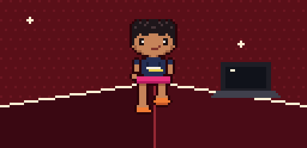

Mahasiswa Teknik Informatika di **UMRAH, Tanjungpinang**. 
Suka ngulik data, bangun backend, dan gambar ERD sebelum ngoding.

### Yang biasa kupakai

  

### Sekarang

- Magang sebagai **Software Engineer Intern** di PT Arus Digital Sinergi
- Lagi belajar **Deep Learning**, **Odoo ERP**, dan **Flutter**
- Project terbaru: [Nocthify](https://github.com/AkbarLingga/Nocthify-erzak) dan [RuangAI](https://github.com/AkbarLingga/RuangAI)

  

